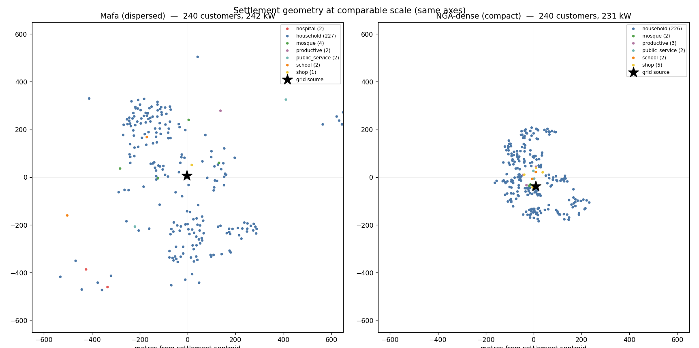
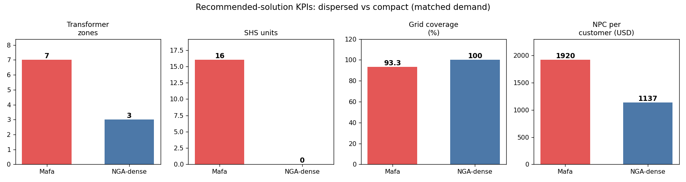
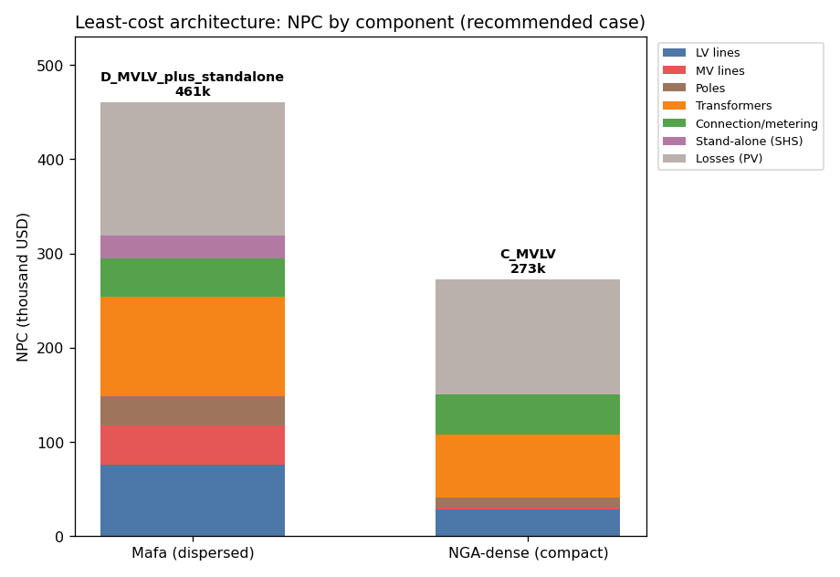

# Preliminary comparative analysis: settlement structure vs least-cost electrification architecture

**Question.** How do two settlement-level parameters — the **geographic dispersion** of the
customers and the **spatial/type distribution of demand** — change (a) the identified
least-cost network architecture (full-LV vs MV/LV) and (b) the identification and coverage
of stand-alone systems (SHS)?

This is a **preliminary** study intended to demonstrate that the methodology is *sensitive*
to these parameters and to size the effect, not to produce a validated plan for either site.

> ⚠️ **Predates the generation-LCOE and coincidence-factor update (2026-07).** The NPC figures,
> per-customer costs, percentages and component-breakdown figures below were produced **before**
> mini-grid generation cost (a levelised LCOE on grid-served energy) was added to `total_npc` and
> before the design power flow moved to a diversified coincidence factor (0.6). With generation cost
> included, absolute NPCs are substantially higher and generation is typically the largest single
> component — so the "LV line + connection capex dominate NPC" narrative below no longer holds in
> absolute terms. The **direction** of the geometry-driven comparison (compact is cheaper than
> dispersed) is expected to survive, but the magnitudes need a re-run before citing. Numbers here are
> retained only as the pre-update baseline.

---

## 1. Method — a controlled two-case comparison

We compare two case studies run through the identical MVP workflow
(`core.workflow.mvp_runner.run_simplified_mvp`), which evaluates four candidate
architectures and recommends the least-cost feasible one:

| Case | Architecture |
|------|--------------|
| A | Full LV grid (single LV network, no transformer) |
| B | Full LV + stand-alone (SHS on uneconomic LV leaf branches) |
| C | MV/LV (settlement partitioned into capacity-limited transformer service zones + MV backbone) |
| D | MV/LV + stand-alone (SHS on uneconomic per-zone leaf branches) |

**Comparison basis (why it is defendable).** The confounder in comparing Mafa with the raw
`nga_1` example is that they differ in demand *scale* (16.6 vs 242 kW) as well as geometry.
We remove that confounder:

* **Held comparable:** connection count (**240 vs 240**) and aggregate peak demand
  (**231 vs 242 kW**, within 5 %). Identical LV/MV/transformer/SHS catalogues, cost
  parameters, demand model, source voltage, and solver settings.
* **Varied:** settlement geometry (dispersed vs compact) and demand distribution
  (institution-dominated vs homogeneous-residential).

Because scale and all engineering/economic assumptions are matched, differences in the
result are attributable to the two parameters under study. The compact case (`nga_dense`)
is built from the **real** NGA 1 georeferenced customers, then densified and diversified —
see [`examples/nga_dense/README_nga_dense.md`](../examples/nga_dense/README_nga_dense.md).

---

## 2. The two settlements



| | **Mafa** (real, dispersed) | **NGA-dense** (compact) |
|---|---|---|
| Customers | 240 | 240 |
| Aggregate peak | 242 kW | 231 kW |
| Annual energy | 532 MWh | 418 MWh |
| Spread from centroid (median / p90 / max) | 288 / 570 / 851 m | 128 / 202 / 255 m |
| Convex-hull area | 0.85 km² | 0.11 km² |
| Density | 284 cust/km² | 2,250 cust/km² |
| Institutions / commercial | 13 | 14 |
| Demand structure | **heavy-tailed**: 2×53 kW hospitals (44 % of load), one ~600 m out | **homogeneous**: largest load 8 kW, all central |

Mafa is a polycentric settlement with a remote must-connect hospital cluster; NGA-dense is a
monocentric, densely built village with its institutions clustered around the grid feed-in.

---

## 3. Results



| Metric | Mafa (dispersed) | NGA-dense (compact) | Δ |
|---|---|---|---|
| **Recommended case** | **D** — MV/LV + SHS | **C** — MV/LV | — |
| Full-LV (A/B) feasible? | No (power flow diverges) | No (power flow diverges) | — |
| NPC total | 460.8 k | 273.0 k | **−41 %** |
| NPC per customer | 1,920 | 1,137 | **−41 %** |
| Transformer zones | 7 | 3 | −57 % |
| SHS units (coverage) | 16 (6.7 %) | 0 (0 %) | −16 |
| Grid coverage | 93.3 % | 100 % | +6.7 pp |
| MV backbone length | 2,932 m | 111 m | **−96 %** |
| LV network length | 6,062 m | 1,558 m | −74 % |
| Poles | 171 | 57 | −67 % |
| Min voltage (horizon) | 0.938 pu | 0.944 pu | — |
| Max line / transformer loading | 93 % / 66 % | 98 % / 76 % | — |



---

## 4. Interpretation

**(i) Geographic dispersion drives the MV backbone and the SHS decision.** At *matched*
demand and connection count, the single clearest signature is the **MV backbone: 2.9 km for
Mafa vs 0.11 km for NGA-dense (a 26× difference)**. Dispersion forces the optimiser to stitch
capacity-limited LV islands together with long MV feeders, roughly doubling the number of
transformer zones (7 vs 3) and tripling pole count. It is also *dispersion*, not demand
scale, that creates the SHS opportunity: Mafa's remote leaf branches are cheaper to serve
with 16 stand-alone systems than to reach with grid, so grid coverage falls to 93 %. In the
compact settlement no branch is remote enough for SHS to beat the grid, so coverage is 100 %
and cases C and D are identical. Net effect: **−41 % NPC per customer purely from compactness.**

**(ii) Demand distribution sets whether full-LV is even on the table.** A single LV network
cannot serve ~230 kW at *any* compactness — the LV voltage drop makes the power flow
non-convergent for both settlements, so full-LV (A/B) is infeasible in both. What the demand
*distribution* changes is the **shape of the MV/LV solution**: Mafa's demand is concentrated
in a few large institutional anchors (two 53 kW hospitals, one remote), which pulls dedicated
transformer capacity toward the settlement edge and inflates the MV backbone; NGA-dense's
homogeneous residential demand lets a few centrally placed transformers cover everyone with
almost no MV. (A companion low-demand residential variant — MTF tier 1–2, ~50–70 kW — would
flip the compact village to a literal full-LV winner; this is the demand-*level* axis, kept
out of scope here in favour of the demand-controlled comparison.)

**(iii) Cost structure.** In both cases the horizon **loss present value** and **transformer
capex** dominate NPC. Dispersion adds three cost layers on top: MV line (47 k → C / 42 k → D
for Mafa vs ~1.6 k for NGA-dense), extra transformers (7 vs 3 zones), and more LV line and
poles. SHS shaves ~10 k off Mafa's NPC (D beats C) but is never selected in the compact case.

---

## 5. Caveats

* **Preliminary, not validated.** NGA-dense's infill dwellings and demand tiers are
  synthetic (seeded, reproducible); the household coordinates and roads are real (NGA 1).
* The `nga_1` road network is sparse (748 m, covering only part of the footprint); pole
  seeding therefore leans on customer positions. This affects LV length absolutes, not the
  qualitative dispersed-vs-compact contrast.
* Zone partitioning is bounded by `max_zone_customers` (140) and `max_lv_zone_radius_m`
  (360 m); the 240-customer settlements therefore need ≥ 2 zones by construction. The
  7-vs-3 difference is well above that floor and is geometry-driven.
* Power-flow "infeasible" for full-LV means non-convergence of the LV-only model at horizon
  demand — read as "LV-only cannot carry this load", not as a numerical artefact.

---

## 6. Reproduce

```bash
# 1. (re)build the compact case study from the real NGA 1 customers
python scripts/build_nga_dense_example.py

# 2. run both case studies and regenerate all figures + docs/figures/case_metrics.json
python scripts/compare_case_studies.py

# single-dataset smoke (either key)
python scripts/smoke_dataset.py mafa
python scripts/smoke_dataset.py nga_dense
```

Machine-readable metrics behind every number above:
[`docs/figures/case_metrics.json`](figures/case_metrics.json).
