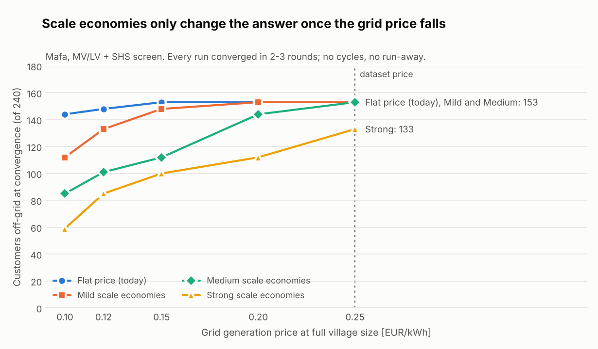

# Convergence experiment: does the generation-cost loop settle?

**Question.** Coupling the network screen to a generation sizing model (MicroGridsPy) needs a
loop. Who is connected sets the plant's load, the plant's load sets its cost, and the cost sets
who is connected. Before integrating MicroGridsPy, does that loop **converge**, **cycle**, or
**run away** (every customer pushed off-grid)?

**Answer on Mafa.** It converges, quickly and without help. That's true for every curve and
every price level tested. But two of our earlier assumptions about *why* the screen behaves as
it does were wrong, and the experiment moves the main risk somewhere else.

Reproduce: `python scripts/convergence_experiment.py` (about 9 min), then
`python scripts/plot_convergence.py`. Raw results:
[`figures/convergence/convergence_results.json`](figures/convergence/convergence_results.json).

---

## Method

MicroGridsPy is replaced by a synthetic plant-cost curve with economies of scale:

```
C(E) = F + k · E^alpha        E = levelised grid-served energy (each customer's annual kWh
                              times its own growth annuity factor, i.e. what the flat LCOE prices)
```

Each curve is **calibrated to cost exactly what the flat price costs at the full village**, so
the two agree at full scale and differ only in shape:

| Shape | Fixed share `F / C(E_full)` | `alpha` | Marginal cost at full size, vs flat price |
|---|---|---|---|
| Flat price (today) | 0 | 1.00 | 100% |
| Mild | 15% | 0.85 | 72% |
| Medium | 30% | 0.70 | 49% |
| Strong | 40% | 0.60 | 36% |

Each shape is tested at five price levels (0.25, 0.20, 0.15, 0.12, 0.10 €/kWh at full size; 0.25
is the dataset's value), both with and without damping, on both SHS screens (B: LV, and D: MV/LV).
That's **70 runs** in total.

Each round of the loop:

1. Every candidate branch gets a generation credit equal to the cost of the plant **with** the
   branch minus the plant **without** it, evaluated at the current state.
2. The production selection (`_select_standalone_clusters`) decides who goes off-grid.
3. The new off-grid set gives the new served energy.

The loop stops when the off-grid set repeats with the served energy settled.

**Harness check.** The flat curve at 0.25 €/kWh reproduces the production pipeline's selection
exactly (139 customers off-grid in screen B, 153 in screen D). The script asserts this, so any
difference elsewhere comes from the curve, not the harness.

**Scope.** Only the generation term moves with the state. The candidate branches and their
network costs come from the Case A tree (screen B) and the Case C zone trees (screen D) and stay
fixed. The realised Case D design is rebuilt once per distinct final state, to price the outcome.

---

## Results



### 1. The loop converges, fast, in every case

- **70 of 70 runs converged.** There were no cycles and no run-away.
- **Undamped:** 2 rounds (31 runs) or 3 rounds (9 runs). **Damped (0.5):** 16–19 rounds, and
  damping **never changed the final answer** (0 of 30 settings). On Mafa, damping only slows
  the loop down.
- **Both forces predicted earlier are present, and the restoring one wins clearly.**
  - The "fixed costs stay" force sets the first round: fewer customers leave than under the flat
    price.
  - The "smaller plant is pricier per kWh" force appears in **9 runs**, as a single correction
    in round 2. It always goes towards *more* off-grid, by 1–16 customers (e.g. 109→125, 133→144),
    and then stops. It never compounds into a spiral.

### 2. At today's price, plausible scale economies change nothing

At 0.25 €/kWh the flat, mild and medium curves give the same answer: **153 off-grid** in screen
D and 139 in screen B. Only the strong curve moves it, to 133.

The decomposition shows why. In screen D, SHS beats the network cost *alone* on **14 of 42**
branches, so generation is irrelevant for those. The other branches do need some generation
credit, but the most sensitive one still clears with **58%** of the flat credit (51% in screen
B). So a curve only moves anything once its marginal cost falls below about half the flat price.

The **price level** is what decides it. At 0.25 €/kWh, the SHS_T2 package already delivers a
typical Mafa household's energy for about **0.22 €/kWh levelised** (NPC 823 € for 400 kWh/yr
growing 4%), with no wires needed. Below roughly 0.20 €/kWh the curve's shape starts to matter a
lot: at 0.10 €/kWh, 144 customers go off-grid under the flat price, against 59 under the strong
curve.

### 3. Coupling is not automatically cheaper: the network side now binds

For the 12 converged settings where coupling changed screen D's answer, the realised design was
priced under the same curve and compared with today's flat-screen answer:

| Price | Shape | Off-grid, coupled / flat | Transformer zones | Coupling saves |
|---|---|---|---|---|
| 0.25 | Strong | 133 / 153 | 7 / 7 | +1,827 (+0.1%) |
| 0.20 | Medium | 144 / 153 | 7 / 7 | +978 (+0.1%) |
| 0.20 | Strong | 112 / 153 | **9** / 7 | **−18,532 (−1.3%)** |
| 0.15 | Mild | 148 / 153 | 7 / 7 | +1,231 (+0.1%) |
| 0.15 | Medium | 112 / 153 | **9** / 7 | **−18,652 (−1.7%)** |
| 0.15 | Strong | 100 / 153 | 8 / 7 | +6,474 (+0.6%) |
| 0.12 | Mild | 133 / 148 | 7 / 7 | +602 (+0.1%) |
| 0.12 | Medium | 101 / 148 | **9** / 7 | **−37,295 (−3.8%)**, coupled design infeasible |
| 0.12 | Strong | 85 / 148 | 7 / 7 | +17,997 (+1.8%) |
| 0.10 | Mild | 112 / 144 | **9** / 7 | **−22,749 (−2.6%)** |
| 0.10 | Medium | 85 / 144 | 7 / 7 | +12,504 (+1.4%) |
| 0.10 | Strong | 59 / 144 | 7 / 7 | +11,532 (+1.3%) |

Coupling was cheaper in 8 of 12 cases and more expensive in 4. **Every one of those 4 is a case
where keeping more customers on the grid pushed the rebuilt MV/LV network from 7 to 9 transformer
zones.** Each case that stayed at 7 or 8 zones saved money.

That jump is a discrete network cost (two more transformers and their MV spurs). The per-branch
screen never sees it: its network credits come from the fixed Case C zone trees, while the
realised design re-runs the zone-count search. This is the "marginal estimate vs realised
rebuild" gap from [`PIPELINE_REVIEW.md`](PIPELINE_REVIEW.md) §3.6, now measured directly. Once
generation is coupled correctly, it becomes the binding source of error.

---

## Corrections to earlier claims

Two statements in this repository's docs were wrong for Mafa. They're corrected where they appear:

1. **"The flat LCOE's lack of scale economies is why the screen moves almost everyone off-grid."**
   At the dataset's price, adding realistic scale economies changes nothing. The outcome is set by
   the price *level* relative to the SHS cost per kWh, plus the absence of any service-quality
   term for SHS. The curve's shape only matters at lower grid prices.
2. **"Expect oscillation; economies of scale are the only restoring force."** Economies of scale
   create *both* forces. On Mafa the restoring force dominates, the opposing one produces a single
   bounded correction, and no oscillation occurs.

One dependency to keep in view: the SHS economics above rest on most households qualifying for
SHS_T2. That's a result of the 2% `standalone_sizing_tolerance` (before it, the median household
needed SHS_T3, at about 0.35 €/kWh levelised). **The SHS-vs-grid balance on Mafa is decided mainly
by which package each household qualifies for**, more than by the generation curve.

---

## What this means for the MicroGridsPy integration

- **Plain substitution is enough on Mafa.** Run the loop without damping, and keep cycle detection
  as a guard: it costs nothing and covers villages that behave differently.
- **A local surrogate is enough.** Decisions settle within one correction of 1–16 customers, so the
  served load at convergence stays close to the first round's. A few MicroGridsPy runs around that
  load should fit the curve where it matters; mapping the whole range isn't needed.
- **Add a realised-cost safeguard before trusting the coupled answer.** After convergence, rebuild
  and compare the coupled design against the flat-screen design and keep the cheaper one. Better
  still, give the screen a view of the zone-count step change. Without that, coupling can make the
  recommended design up to 3.8% more expensive, and in one case infeasible.
- **The biggest levers are outside the curve:** the SHS package catalogue, the eligibility
  tolerance, and a service-quality term that compares an SHS tier fairly with a grid connection.
  The plan for these is in [`SERVICE_QUALITY_ROADMAP.md`](SERVICE_QUALITY_ROADMAP.md).

## Caveats

- These are synthetic curves, not MicroGridsPy output. The real curve's shape is unknown, and it
  also depends on the load shape, not only on energy.
- One village, one deterministic run, and illustrative cost data.
- Only the generation term is coupled. The candidate trees are fixed, so a loop that also rebuilt
  the zones each round could behave differently.
- The realised comparison covers screen D only. Screen B's realised designs are infeasible on Mafa
  at any of these states (flat LV can't carry the load), so they weren't priced.
