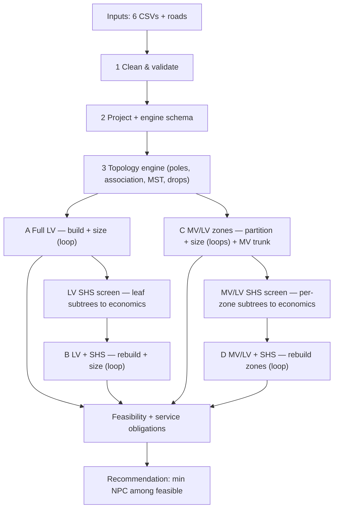

# Workflow — Plain-Language Walkthrough

How the simplified LV/MV + stand-alone MVP runs, end to end: what each stage does, the data passed
between stages, the iterative loops, and where a step declares **infeasible**. For exact equations and
parameter defaults see [`MODEL_REFERENCE.md`](MODEL_REFERENCE.md).

**The big idea in one sentence.** Take a village of customers, draw four ways to electrify it — full
low-voltage grid (**A**), full LV with some houses on solar (**B**), a medium-voltage backbone feeding
local transformer zones (**C**), and that MV/LV grid with some houses on solar (**D**) — cost each one
over its lifetime, and recommend the cheapest one that physically works.

Everything is **deterministic** and **sequential** (no optimization solver): each candidate is built,
simulated with a power flow, and costed. Entry point: `run_simplified_mvp` in
`core/workflow/mvp_runner.py`.

Stages 1–3 run **once** and feed every candidate. `A → LV screen → B` and `C → MV/LV screen → D` are
**independent** tracks (D never reuses B's selection).

---

## Stage 1 — Clean & validate the inputs
*`core/io/load_inputs.py` → `core/io/input_schemas.py`*

**Plain words:** read the input files and make them trustworthy before anything else touches them.

- **Data injected:** `customers.csv`, `source.csv`, `lv_conductors.csv`, `mv_conductors.csv`,
  `transformers.csv`, `standalone_packages.csv`, `cost_parameters` (CSV/YAML), optional `roads`.
- **What it does (`normalize_*`):** enforces required columns; coerces numerics; **fills defaults**
  for anything missing (e.g. `peak_kw_now=0.3`, `annual_kwh_now = peak·8760·0.2`, `power_factor=0.90`
  clamped to [0.5,1.0], `growth_rate=0.03`, `demand_tier=2`); derives flags — `can_be_standalone_flag`
  defaults `True` except grid-priority types (`clinic, hospital, school, productive, water_pump`), and
  **`must_connect ⇒ can_be_standalone=False`**. `cost_parameters` are back-filled from
  `COST_PARAMETER_DEFAULTS`.
- **Hard stop (run never starts), raises `ValueError`:** missing required columns; **duplicate
  `customer_id`**; missing/invalid latitude or longitude.
- **Dependency:** every later stage consumes these cleaned tables; the cost/engineering parameters fan
  out to sizing, costing, and the SHS screens.

## Stage 2 — Project to metric CRS + map to the engine schema
*`load_inputs.customers_to_engine_gdf`*

**Plain words:** convert lat/lon to metres so distances are real, and rename columns to what the
topology engine expects.

- **Injected:** cleaned customers → a projected `GeoDataFrame` + `crs_meta` (auto-selected UTM-like CRS).
- **Produces:** engine columns (`consumer_type`, `peak_kw`, `priority_score`, positional `building_id`),
  stable string `customer_id`.
- **Dependency:** all topology building runs in this projected frame, so `service_drop_m`, branch
  lengths and zone radii are all in metres.

## Stage 3 — Topology engine (shared by every candidate)
*`core/topology/lv_topology.py` → reuses `core.distribution_service._run_low_voltage_core`*

**Plain words:** decide where the poles go, which pole each house hangs off, and string the poles into
a tree.

- **Injected:** projected customers (optionally a subset via `customer_ids`), roads, and engineering
  knobs: `road_pole_spacing_m`, `max_user_connection_radius_m`, `max_users_per_pole`, `max_pole_span_m`.
- **Produces an `LVTopology`:** `pole_xy`, a rooted **graph** (slack = pole nearest the source),
  `customer_pole` / `pole_customers`, `service_drop_m[i] = dist(house_i, its pole)`, and crucially
  `served_customer_ids` vs **`unserved_customer_ids`** (a customer the engine cannot associate to a
  pole is dropped as *unserved*).
- **Reusable workhorse:** called for the **full** village (A), the **rebuilt** remainder (B), **each
  MV/LV zone**, and the **MV trunk** (transformers treated as pseudo-customers).
- **Soft infeasibility:** unserved customers propagate to "service-tier violations" downstream and are
  drawn grey on the result map.

---

## Stage 4 — Candidate A (Full LV) + the conductor-sizing loop
*`_run_full_lv` + `core/electrical/conductor_sizing.py` + `core/electrical/validation.py`*

**Plain words:** put the whole village on one LV network, then pick the cheapest wire per line that
doesn't overload or sag.

- **The iterative loop (`size_conductors`):**
  1. start every line at **rank 0** (cheapest);
  2. build the pandapower net (`build_lv_net`), run power flow at the **horizon design** demand
     `P_i,now·(1+g_i)^T·cf` (diversified by the **coincidence factor** `cf`, default 0.6);
  3. **feasible? → stop**;
  4. else find **critical lines** = overloaded lines **+** lines on the slack→undervoltage-bus path
     (`critical_lv_lines`); if none can be isolated → **upgrade all**;
  5. bump each critical line up one rank; repeat.
- **Loop exit / infeasibility:** feasible; **`max_iters = 8`** reached; **no larger conductor** exists;
  or **2 consecutive non-convergences** → early bail (voltage collapse can't be reconductored away).
- **Feasible** (`run_powerflow`) iff PF converged **and** `min_vm ≥ v_min`, `max_vm ≤ v_max`,
  `max_line_loading ≤ limit`, `max_trafo_loading ≤ limit`; otherwise `active_bottleneck` names the breach.
- **Then costs** (`cost_model.py`): LV line + poles + connection/metering + present value of losses +
  **mini-grid generation** (`generation_lcoe_per_kwh · grid-served annual kWh · AF`, so grid energy is
  costed the same way SHS energy already is inside its package — no double count).
- **Three PF snapshots are stored:** **now** (reference), **horizon design** (binding, `cf`-diversified),
  and a **coincident-peak stress** snapshot (`cf = 1.0`, everyone at once) — reported as a robustness
  check, never gating feasibility.
- **Handed forward:** A's solved model + `grid_customer_ids` feed the LV SHS screen and Case C.

## Stage 5 — LV SHS screen (leaf-branch pruning) → Candidate B
*`branch_detection.subtree_clusters` + `subtree_candidates.terminal_subtrees` + `_select_standalone_clusters` + `_run_lv_standalone`*

**Plain words:** look at the dangly ends of the LV tree; if solar is cheaper than the wire reaching
them, cut them loose.

- **Candidate generation (`terminal_subtrees`):** root the LV tree at the source; a **fork** = node
  with ≥ 2 children; each child's downstream **subtree** is a candidate "leaf branch". Trunks and the
  whole network are excluded by construction; subtrees **nest** and form a laminar family.
- **Per-branch economics:**
  - **Avoided grid cost** (`_avoided_lv_cost`) = branch line cost (internal + entry edge) + service-drop
    proxy (cheapest LV conductor) + connection/metering + **all** dedicated poles + PV of that branch's
    losses (from A's power flow).
  - **SHS NPC** (`standalone.cluster_standalone` → `npc.standalone_npc`) = per-customer cheapest feasible
    solar package summed: `NPC = capex + PV(O&M) + PV(replacements) − PV(salvage)`.
- **Decision (purely economic, greedy):** evaluate candidates **largest-avoided-first**; skip a branch
  whose customers are already claimed (handles nesting); select **iff `SHS_NPC < avoided`**. Engineering
  thresholds (branch cost/customer, undervoltage, largest-conductor) are **diagnostic flags only**;
  `dmax`/`lmax` were removed.
- **Blocked (cannot be pruned):** any customer is `must_connect` or `¬can_be_standalone`; or **no
  package** satisfies tier/peak/energy.
- **Candidate B (`_run_lv_standalone`):** remove the selected SHS customers, **rebuild the LV topology
  on the remainder, re-run the sizing loop**, re-cost; SHS NPC folds into B's total. If nothing was
  selected, B = A.

## Stage 6 — Candidate C (MV/LV service zones) + nested sizing loops
*`mvlv_service_zones.py` + `_run_mvlv` + `_build_mvlv`*

**Plain words:** for a big/spread village a single LV grid collapses, so split it into transformer
"neighborhoods" fed by an MV backbone.

- **Partition (`partition_service_zones`, greedy farthest-first):** seed = customer farthest from
  source; grow by nearest customers while `dist ≤ max_lv_zone_radius_m`, `members < max_zone_customers`,
  and coincident `S ≤ max_zone_kva` (largest transformer derated ÷ 1.2); repeat until all assigned.
  Every grid customer lands in exactly one zone.
- **Per zone:** transformer at the zone centroid (snapped to road); a **local LV tree** (Stage 3) → its
  own **sizing loop**; transformer = smallest rank with `sn·max_loading%/100 ≥ 1.2·S_zone`.
- **MV trunk:** an MST `LVTopology` over `{source} ∪ {transformers}`, then an **MV-conductor upgrade
  loop** (rank up the single MV conductor until the whole MV/LV power flow passes).
- **Source model:** slack at `source_vm_pu = 1.04`; **no explicit step-up transformer** (MVP
  simplification).
- **Infeasibility:** any zone/MV PF failing limits, or the MV loop running out of conductor ranks.

## Stage 7 — MV/LV SHS screen → Candidate D
*`detect_mvlv_subtree_candidates` + `_select_standalone_clusters` + `_run_mvlv_standalone`*

**Plain words:** same leaf-branch pruning as B, but applied **inside each transformer zone's** LV tree —
so D gets its **own** solar set, not B's.

- **Candidates:** `terminal_subtrees` of **each zone's** LV tree, id-namespaced (`Z03-S01`).
- **Avoided cost (`_avoided_mvlv_subtree_cost`, deliberately conservative):** LV branch + drops + poles
  + connection — **no loss term, and no per-branch transformer/MV credit**. The transformer/MV saving
  is realized only implicitly: a zone that fully empties simply isn't rebuilt.
- **Same greedy economic selection; same blocking rules.**
- **Candidate D (`_run_mvlv_standalone`):** drop the selected SHS customers, **re-partition and rebuild
  MV/LV** over the remainder. If none selected, D = C.

---

## Stage 8 — Service obligations + recommendation
*`run_simplified_mvp` tail*

For **every** candidate:

- `must_connect_violations = |must_connect − grid_customers|` → **> 0 forces infeasible** (a priority
  customer left off-grid is unacceptable).
- `service_tier_violations = |all − (grid ∪ standalone)|` → reported (this is where Stage-3 unserved
  customers surface; the map colors them grey).
- **Recommend:** `argmin total_npc` among **feasible** (NPC now includes mini-grid generation cost); if
  none feasible, the least-infeasible by NPC (with its bottleneck reported).
- **Also reported (not part of the decision):** a **coincident-peak stress** comparison (`coincident_*`
  columns — how each candidate holds up with every user at peak at once); a **tier-served** table (grid
  connections stay expandable, SHS are capped at their package's service tier — future-demand headroom);
  and a **parallel-coordinates** plot of the **feasible** solutions across total NPC, total tier capacity
  and coincident-peak min voltage (each normalized so up = better).

---

## Dependencies & data injection at a glance

| Step | Consumes | Produces / injects downstream |
|---|---|---|
| 1 Clean | raw files | clean tables + cost/eng params (used everywhere) |
| 2 Project | clean customers | projected gdf + `crs_meta` |
| 3 Engine | projected gdf, roads, eng knobs | `LVTopology` (served/unserved, drops, graph) |
| 4 A | full topology, LV catalogue, constraints | sized model, horizon PF, `grid_customer_ids`, losses |
| 5 B | A's tree + A's PF losses, packages, costs | SHS set → rebuilt LV |
| 6 C | A's grid ids, zone/TX/MV catalogues | zones, transformers, MV trunk, PF |
| 7 D | **C's** zone trees, packages, costs | zone-local SHS set → rebuilt MV/LV |
| 8 Eval | all 4 cases + must/standalone flags | feasibility + recommendation + coincident-peak stress, tier-served & parallel-coordinates comparison |

## Loops & infeasibility, summarized

- **Iterative loops:** conductor sizing runs inside A, B, *every* C/D zone, and the MV trunk
  (cheapest → upgrade critical lines → repeat).
- **Infeasibility branches:** PF non-convergence; any voltage/loading limit breach; a `must_connect`
  customer left off-grid; no remaining conductor rank; or no feasible SHS package (this last one blocks
  *pruning*, not the candidate itself).
