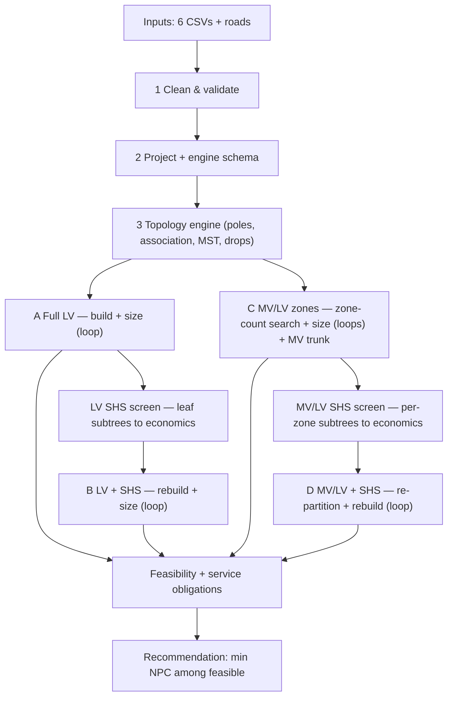

# Workflow — Plain-Language Walkthrough

How the simplified LV/MV + stand-alone workflow runs, end to end: what each stage does, the data
passed between stages, the iterative loops, and where a step declares **infeasible**. For exact
equations and parameter defaults see [`MODEL_REFERENCE.md`](MODEL_REFERENCE.md); for the known
weaknesses see [`PIPELINE_REVIEW.md`](PIPELINE_REVIEW.md).

**The big idea in one sentence.** Take a village of customers, draw four ways to electrify it — full
low-voltage grid (**A**), full LV with some houses on solar (**B**), a medium-voltage backbone feeding
local transformer zones (**C**), and that MV/LV grid with some houses on solar (**D**) — cost each one
over its lifetime, and recommend the cheapest one that physically works.

Everything is **deterministic** and **sequential** (no optimization solver): each candidate is built,
simulated with a power flow, and costed. Entry point: `run_simplified_mvp` in
`core/workflow/mvp_runner.py`.

Stages 1–3 run **once** and feed every candidate. `A → LV screen → B` and `C → MV/LV screen → D` are
**independent** tracks (D never reuses B's selection).

---

## Stage 1 — Clean & validate the inputs
*`core/io/load_inputs.py` → `core/io/input_schemas.py`*

**Plain words:** read the input files and make them trustworthy before anything else touches them.

- **Data injected:** `customers.csv`, `source.csv`, `lv_conductors.csv`, `mv_conductors.csv`,
  `transformers.csv`, `standalone_packages.csv`, `cost_parameters` (CSV/YAML), optional `roads`.
- **What it does (`normalize_*`):** enforces required columns; coerces numerics; **fills defaults**
  for anything missing (e.g. `peak_kw_now=0.3`, `annual_kwh_now = peak·8760·0.2`, `power_factor=0.90`
  clamped to [0.5,1.0], `growth_rate=0.03`, `demand_tier=2`); derives flags —
  `can_be_standalone_flag` defaults `True` except grid-priority types (`clinic, hospital, school,
  productive, water_pump`), and **`must_connect ⇒ can_be_standalone=False`**. `cost_parameters` are
  back-filled from `COST_PARAMETER_DEFAULTS`.
- **Hard stop (run never starts), raises `ValueError`:** missing required columns; **duplicate
  `customer_id`**; missing/invalid latitude or longitude; an out-of-range `clustering_criterion` or
  `k_selection_snapshot`.
- **Warns:** an **unrecognised** cost-parameter key, with a did-you-mean suggestion. These used to be
  dropped in silence, so a typo (`discount_rte`) was accepted, the default was used, and the run
  looked fine while answering a different question. Four **retired** keys
  (`dmax_lv_service_zone_m`, `lmax_lv_path_m`, `remote_branch_length_threshold_m`,
  `loss_threshold_percent`) are still accepted quietly so older datasets keep loading.
- **Dependency:** every later stage consumes these cleaned tables; the cost/engineering parameters fan
  out to sizing, costing, and the SHS screens.

## Stage 2 — Project to metric CRS + map to the engine schema
*`load_inputs.customers_to_engine_gdf`*

**Plain words:** convert lat/lon to metres so distances are real, and rename columns to what the
topology engine expects.

- **Injected:** cleaned customers → a projected `GeoDataFrame` + `crs_meta` (auto-selected UTM-like CRS).
- **Produces:** engine columns (`consumer_type`, `peak_kw`, `priority_score`, positional `building_id`),
  stable string `customer_id`.
- **Dependency:** all topology building runs in this projected frame, so `service_drop_m`, branch
  lengths and zone radii are all in metres.

Alongside this, `build_context` assembles the run context every costing helper reads — the per-customer
energy and growth lookups, the resolved transformer-sizing coincidence basis, the constraint set. It is
one builder so the contract lives in one place.

## Stage 3 — Topology engine (shared by every candidate)
*`core/topology/lv_topology.py` → reuses `core.distribution_service._run_low_voltage_core`*

**Plain words:** decide where the poles go, which pole each house hangs off, and string the poles into
a tree.

- **Injected:** projected customers (optionally a subset via `customer_ids`), roads, and engineering
  knobs: `road_pole_spacing_m`, `max_user_connection_radius_m`, `max_users_per_pole`, `max_pole_span_m`.
- **Produces an `LVTopology`:** `pole_xy`, a rooted **graph** (slack = pole nearest the source),
  `customer_pole` / `pole_customers`, `service_drop_m[i] = dist(house_i, its pole)`, and crucially
  `served_customer_ids` vs **`unserved_customer_ids`** (a customer the engine cannot associate to a
  pole is dropped as *unserved*).
- **Reusable workhorse:** called for the **full** village (A), the **rebuilt** remainder (B), **each
  MV/LV zone**, and the **MV trunk** (transformers treated as pseudo-customers).
- **Soft infeasibility:** unserved customers propagate to "service-tier violations" downstream and are
  drawn grey on the result map.
- The backbone minimises **length** (an MST), not voltage drop or losses; the electrics are repaired
  afterwards by reconductoring. Service drops are **priced but carry no impedance**.

---

## Stage 4 — Candidate A (Full LV) + the conductor-sizing loop
*`_run_full_lv` + `core/electrical/conductor_sizing.py` + `core/electrical/validation.py`*

**Plain words:** put the whole village on one LV network, then pick the cheapest wire per line that
doesn't overload or sag.

- **The iterative loop (`size_conductors`):**
  1. start every line at **rank 0** (cheapest);
  2. build the pandapower net (`build_lv_net`), run power flow at the **horizon design** demand
     `P_i,now·(1+g_i)^T·cf` (diversified by the **coincidence factor** `cf`, default 0.6);
  3. **feasible? → stop**;
  4. else find **critical lines** = overloaded lines **+** lines on the slack→undervoltage-bus path
     (`critical_lv_lines`); if none can be isolated → **upgrade all**;
  5. bump each critical line up one rank; repeat.
- **Loop exit / infeasibility:** feasible; **`max_iters = 8`** reached; **no larger conductor** exists;
  or **2 consecutive non-convergences** → early bail (voltage collapse can't be reconductored away).
- **Feasible** (`run_powerflow`) iff PF converged **and** `min_vm ≥ v_min`, `max_vm ≤ v_max`,
  `max_line_loading ≤ limit`, `max_trafo_loading ≤ limit`; otherwise `active_bottleneck` names the breach.
  A non-converged solve returns every metric as `NaN` and **no limit check runs** — a `NaN` comparison
  is always `False` and would otherwise read as "within limits".
- **Then costs** (`cost_model.py`): LV line + poles + connection/metering + **service drops** +
  present value of losses + **mini-grid generation**. Both energy streams are levelised over their
  actual growth trajectory; losses are priced at the generation LCOE, because loss energy is generated
  energy that never arrives.
- **Three PF snapshots are stored:** **now** (reference), **horizon design** (binding, `cf`-diversified),
  and a **coincident-peak stress** snapshot (`cf = 1.0`, everyone at once) — reported as a robustness
  check, never gating feasibility.
- **Handed forward:** A's solved model + `grid_customer_ids` feed the LV SHS screen and Case C.

## Stage 5 — LV SHS screen (leaf-branch pruning) → Candidate B
*`branch_detection.subtree_clusters` + `subtree_candidates.terminal_subtrees` + `_select_standalone_clusters` + `_run_lv_standalone`*

**Plain words:** look at the dangly ends of the LV tree; if solar is cheaper than the wire reaching
them, cut them loose.

- **Candidate generation (`terminal_subtrees`):** root the LV tree at the source; a **fork** = node
  with ≥ 2 children; each child's downstream **subtree** is a candidate "leaf branch". Trunks and the
  whole network are excluded by construction; subtrees **nest** and form a laminar family.
- **Per-branch economics:**
  - **Avoided grid cost** (`_avoided_lv_cost`) = branch line cost (internal + entry edge) + service
    drops + connection/metering + **all** dedicated poles + avoided grid **generation** + PV of that
    branch's losses. Every term calls the **same helper** the candidate NPC charges, so the gate
    cannot be paid for a saving the objective does not recognise.
  - **SHS NPC** (`standalone.cluster_standalone` → `npc.standalone_npc`) = per-customer cheapest
    feasible solar package summed: `NPC = capex + PV(O&M) + PV(replacements) − PV(salvage)`. Package
    eligibility sizes **both** peak and energy at the horizon and allows a small
    `standalone_sizing_tolerance` (default 2%), because the catalogue is discrete and the exact test
    was a knife edge.
- **Decision (purely economic, greedy):** evaluate candidates **largest-avoided-first**; skip a branch
  whose customers are already claimed (handles nesting); select **iff `SHS_NPC < avoided`**. Engineering
  thresholds are **diagnostic flags only**.
- **Blocked (cannot be pruned):** any customer is `must_connect` or `¬can_be_standalone`; or **no
  package** satisfies tier/peak/energy.
- **Candidate B (`_run_lv_standalone`):** remove the selected SHS customers, **rebuild the LV topology
  on the remainder, re-run the sizing loop**, re-cost; SHS NPC folds into B's total. If nothing was
  selected, B = A.

> **Known limitation.** On the real case studies this gate accepts **every** candidate branch (17/17
> in B, 22/22 in D on Mafa, moving 139–153 of 240 customers off-grid). Avoided generation dominates
> the avoided cost and a flat LCOE has no economies of scale, so nothing restores the balance as load
> leaves the grid. See [`PIPELINE_REVIEW.md`](PIPELINE_REVIEW.md) §3.1.

## Stage 6 — Candidate C (MV/LV service zones) + nested sizing loops
*`mvlv_service_zones.py` + `_run_mvlv` + `_build_mvlv` + `_voltage_cap_search`*

**Plain words:** for a big/spread village a single LV grid collapses, so split it into transformer
"neighborhoods" fed by an MV backbone, and let the power flow decide how many you need.

- **How many transformers?** `clustering_criterion` decides. The default `voltage_cap` **searches** the
  zone count:
  - the partition family is a **Ward dendrogram cut at `k`**, so `k+1` **refines** `k` (a zone is
    split, never reshuffled). The previous k-means-per-`k` re-solved from scratch, which made the
    worst voltage drop non-monotone in `k` — something a search that stops at the first failure
    cannot rest on;
  - a count is **accepted** only with a **declared voltage margin** on top of the limit
    (`design_voltage_margin_pu`, default 0.02 pu), so the chosen design is not left sitting on the
    constraint;
  - the margin is a **preference, not a constraint**: more transformers shorten LV feeders but
    lengthen the MV trunk and add another transformer impedance, so the achievable voltage
    **plateaus**. When no count reaches the margin the search falls back to the **smallest feasible**
    count and records why; if nothing is feasible it reports the least-violating partition.
  - `k` never exceeds the customer count; diverged attempts step geometrically; the climb stops once
    extra transformers stop buying voltage, but only once something feasible is in hand.
  - `distance_cap` instead guarantees a cluster diameter by construction (no search, no power flow);
    `capacity` is the legacy greedy packing and is the only criterion that reads
    `max_lv_zone_radius_m` / `max_zone_customers`.
- **Per zone:** transformer at the zone centroid (snapped to road), sized on the zone's apparent power
  at `transformer_sizing_coincidence_factor` × 1.2; a **local LV tree** (Stage 3) → its own **sizing
  loop**.
- **MV trunk:** an MST `LVTopology` over `{source} ∪ {transformers}`, then an **MV-conductor upgrade
  loop** (one conductor type for the whole trunk, ranked up until the full MV/LV power flow passes).
- **Source model:** a **single slack on the plant LV bus** at `source_vm_pu` (default 1.0) and an
  **explicit step-up transformer** feeding the MV backbone. (The flat-LV cases A/B get an ideal 0.4 kV
  slack with no plant transformer — an asymmetry in their favour.)
- **Infeasibility:** any zone/MV PF failing limits, or the MV loop running out of conductor ranks.

## Stage 7 — MV/LV SHS screen → Candidate D
*`detect_mvlv_subtree_candidates` + `_select_standalone_clusters` + `_run_mvlv_standalone`*

**Plain words:** same leaf-branch pruning as B, but applied **inside each transformer zone's** LV tree —
so D gets its **own** solar set, not B's.

- **Candidates:** `terminal_subtrees` of **each zone's** LV tree, id-namespaced (`Z03-S01`).
- **Avoided cost (`_avoided_mvlv_subtree_cost`):** LV branch + drops + poles + connection + avoided
  grid generation — but **no loss term and no per-branch transformer/MV credit**. The transformer/MV
  saving is realized only implicitly: a zone that fully empties simply isn't rebuilt. Deliberately
  conservative.
- **Same greedy economic selection; same blocking rules.**
- **Candidate D (`_run_mvlv_standalone`):** drop the selected SHS customers, **re-partition and rebuild
  MV/LV** over the remainder — including a fresh zone-count search. If none selected, D = C.

> Because D re-partitions from scratch, the branch/pole credits that drove its decisions refer to
> Case C's geometry, which no longer exists in the realised candidate.

---

## Stage 8 — Service obligations + recommendation
*`run_simplified_mvp` tail*

For **every** candidate:

- `must_connect_violations = |must_connect − grid_customers|` → **> 0 forces infeasible** (a priority
  customer left off-grid is unacceptable).
- `service_tier_violations = |all − (grid ∪ standalone)|` → reported (this is where Stage-3 unserved
  customers surface; the map colors them grey).
- **Recommend:** `argmin total_npc` among **feasible**. If **none** is feasible, the fallback does
  **not** use NPC — a diverged candidate has no computable loss cost, so its total is a lower bound
  and it would win precisely *because* it is broken. Candidates are ranked instead by: power flow
  converged → service obligations → `violation_severity` (distance from the limits) → cost
  completeness → cost.
- Candidates whose cost is incomplete carry `npc_complete = False` and
  `npc_missing_components`, so an unknown component is never mistaken for a zero one.
- **Also reported (not part of the decision):** a **coincident-peak stress** comparison
  (`coincident_*` columns); a **tier-served** table (grid connections stay expandable, SHS are capped
  at their package's service tier); and a **parallel-coordinates** plot of the **feasible** solutions
  across total NPC, total tier capacity and coincident-peak min voltage.

---

## Dependencies & data injection at a glance

| Step | Consumes | Produces / injects downstream |
|---|---|---|
| 1 Clean | raw files | clean tables + cost/eng params (used everywhere) |
| 2 Project | clean customers | projected gdf + `crs_meta` + the run context |
| 3 Engine | projected gdf, roads, eng knobs | `LVTopology` (served/unserved, drops, graph) |
| 4 A | full topology, LV catalogue, constraints | sized model, horizon PF, `grid_customer_ids`, losses |
| 5 B | A's tree + A's PF losses, packages, costs | SHS set → rebuilt LV |
| 6 C | A's grid ids, zone/TX/MV catalogues | zones, transformers, MV trunk, PF, zone-count history |
| 7 D | **C's** zone trees, packages, costs | zone-local SHS set → re-partitioned MV/LV |
| 8 Eval | all 4 cases + must/standalone flags | feasibility + recommendation + stress, tier-served & trade-off comparison |

## Loops & infeasibility, summarized

- **Iterative loops:** conductor sizing runs inside A, B, *every* C/D zone, and the MV trunk
  (cheapest → upgrade critical lines → repeat); on top of that the `voltage_cap` **zone-count search**
  rebuilds the entire MV/LV network once per attempted `k`, for both C and D.
- **Infeasibility branches:** PF non-convergence; any voltage/loading limit breach; a `must_connect`
  customer left off-grid; no remaining conductor rank; no zone count that holds the voltage; or no
  feasible SHS package (this last one blocks *pruning*, not the candidate itself).
- **Cost of the search.** Each `k` attempt is a full plan build + per-zone sizing + MV rank sweep, so a
  240-customer settlement takes a few minutes end to end (measured ~240 s for Mafa without numba).
  `max_transformers` bounds the worst case.
